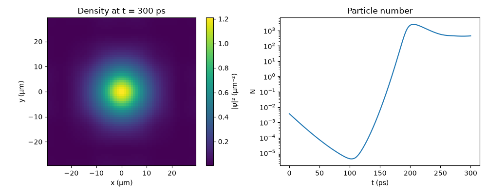

# Quickstart

Pump a Gaussian spot above threshold, watch a condensate form, and plot the result. The run takes a few seconds on a laptop CPU.

## Run from Python

Save this as `run.py`:

```python
import polarism as ps

cfg = ps.Config()
cfg.grid.nx = 64
cfg.grid.ny = 64
cfg.grid.lx = 60.0
cfg.grid.ly = 60.0
cfg.laser.laser_type = "continuous-gaussian"
cfg.laser.P0 = 0.3
cfg.laser.sigma_space = 6.0
cfg.solver.method = "ifrk-fft-cuda"
cfg.solver.tableau = "dop853"
cfg.solver.adaptive = True
cfg.solver.dt = 0.1
cfg.solver.total_time = 300.0
cfg.result.save_results = True
cfg.result.formats = ("hdf5",)
cfg.result.save_every = 1.0
cfg.result.output_directory = "quickstart_results"
controller = ps.SimulationController(cfg)
controller.run()
print(controller.run_directory)
```

```bash
python run.py
```

What this sets up:

- a periodic 60 µm × 60 µm box with 64 × 64 points;
- a continuous Gaussian pump of peak rate 0.3 µm⁻² ps⁻¹ and width 6 µm, feeding the default `double` reservoir;
- the spectral `ifrk-fft-cuda` solver (it also runs on CPU) with adaptive DOP853 steps; `dt` is the 0.1 ps output tick, not the integration step;
- one saved frame per ps in HDF5, written to a timestamped directory inside `quickstart_results/`.

The initial field is weak random noise, so every run starts from a different seed unless you set `cfg.noise.seed`.

## Run from YAML

The same run as `run.yaml`:

```yaml
grid:
  nx: 64
  ny: 64
  lx: 60.0
  ly: 60.0
laser:
  laser_type: continuous-gaussian
  P0: 0.3
  sigma_space: 6.0
solver:
  method: ifrk-fft-cuda
  tableau: dop853
  adaptive: true
  dt: 0.1
  total_time: 300.0
result:
  save_results: true
  formats: [hdf5]
  save_every: 1.0
  output_directory: quickstart_results
```

```bash
polarism --config run.yaml
```

Any field can be overridden on the command line, for example `polarism --config run.yaml --laser.P0 0.5`.

## Plot the result

```python
from pathlib import Path

import matplotlib.pyplot as plt
import polarism as ps

run_dir = max(Path("quickstart_results").iterdir())
with ps.load_results(run_dir) as results:
    density = results.fields["density"][-1]
    norm = results.scalars["norm"][:]
    figure, (left, right) = plt.subplots(1, 2, figsize=(10, 4))
    image = left.imshow(density, origin="lower",
                        extent=[results.x[0], results.x[-1], results.y[0], results.y[-1]])
    left.set(xlabel="x (µm)", ylabel="y (µm)", title=f"Density at t = {results.time[-1]:.0f} ps")
    figure.colorbar(image, ax=left, label="|ψ|² (µm⁻²)")
    right.semilogy(results.time, norm)
    right.set(xlabel="t (ps)", ylabel="N", title="Particle number")
    figure.tight_layout()
    figure.savefig("quickstart.png")
```



The particle number first decays while the reservoir fills. Once the reservoir under the spot exceeds threshold, the condensate grows exponentially, overshoots, and settles into a steady state after a damped relaxation oscillation. The density map shows the condensate localized under the pump spot.

## Next steps

- [Configure a run](../user-guide/configuration.md): Python, YAML, the CLI and units.
- [Pumps and reservoirs](../user-guide/pumps-and-reservoirs.md): other pump shapes and reservoir models.
- [Output and results](../user-guide/output-and-results.md): what is saved and how to read it.
- [Observables and spectra](../user-guide/observables-and-spectra.md): n(k), g1, g2 and E(k).
- [Running on GPUs](../user-guide/running-on-gpus.md): the same run on a CUDA device.
